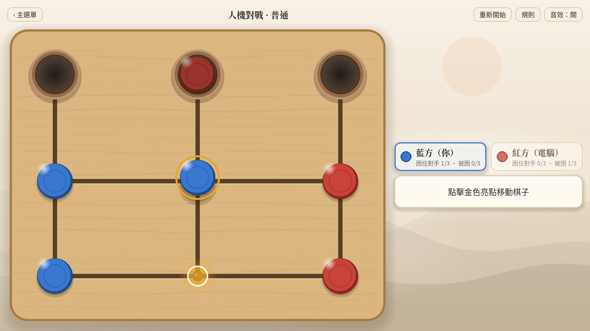
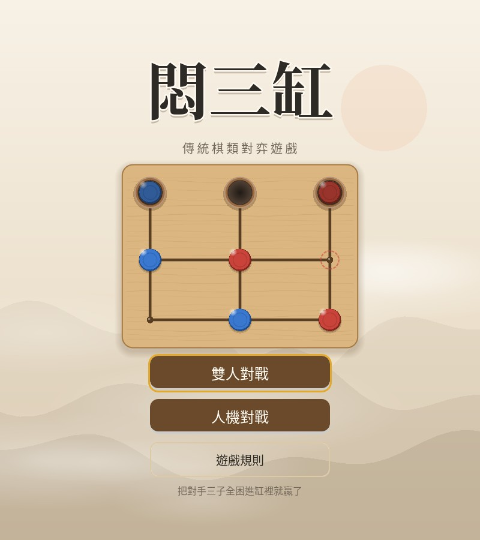
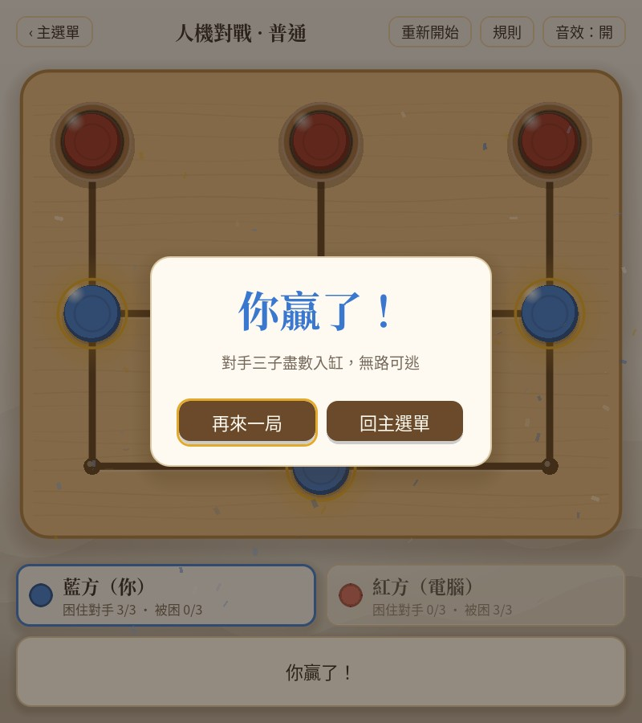

# 悶三缸

一款傳統的兩人棋類對弈遊戲：把對手的三顆棋子全部困進棋盤上方的三個「缸」裡，你就贏了。

使用 [Godot 4.7](https://godotengine.org/) 製作，支援 Windows、macOS、Android 與網頁版。

**🌐 [線上試玩](https://ddfg3630.github.io/men-san-gang/)**　·　**📦 [下載最新版](https://github.com/ddfg3630/men-san-gang/releases/latest)**



<p align="center">
  
  
</p>

## 遊戲規則

棋盤共九個點：上方三個「缸」，下面是中排與下排各三點，點與點之間以線相連。

| 項目 | 說明 |
|---|---|
| **開局** | 藍方三子在左列、紅方三子在右列，藍方先走。 |
| **走法** | 每回合沿線把自己的一顆棋子移到相鄰的空點。 |
| **禁回頭** | 不能立刻把上一步走回去；若因此無路可走，限制自動解除。 |
| **讓路** | 一方被堵死時，對手必須走一步替他解圍。雙方都動不了則為平局。 |
| **勝利** | 走完一步時，對手三子全都在缸裡，你就獲勝。自己把最後一子走進缸不會當場判輸，但對手下一步走完就分出勝負。 |

## 功能

- **雙人對戰**：同一台裝置輪流下棋
- **人機對戰**：可選陣營與簡單／普通／困難三種難度（Minimax 搜尋 AI）
- **自適應版面**：橫向螢幕棋盤在左、資訊在右；直向螢幕（手機）資訊在下
- **對弈特效**：落子漣漪、入缸震動、讓路提示、勝利彩紙與音效（可關閉）
- **動態水墨背景**：遠山、霧氣與飄落的梅花，色調隨輪到的一方變化

## 下載與安裝

到 [Releases](https://github.com/ddfg3630/men-san-gang/releases/latest) 下載對應平台的檔案：

| 平台 | 檔案 | 說明 |
|---|---|---|
| Windows | `MenSanGang-*-Windows.exe` | 雙擊即可遊玩 |
| macOS | `MenSanGang-*-macOS.zip` | 解壓縮後，在 Finder 對 App 按右鍵 →「打開」（未經 Apple 簽名） |
| Android | `MenSanGang-*-Android.apk` | 需允許安裝未知來源的應用程式 |
| Web | `MenSanGang-*-Web.zip` | 解壓縮後放到任何靜態網頁空間即可 |

## 從原始碼執行

1. 安裝 [Godot 4.7](https://godotengine.org/download/)（標準版即可，不需要 .NET）
2. 複製這個專案：
   ```bash
   git clone https://github.com/ddfg3630/men-san-gang.git
   ```
3. 在 Godot 專案管理器中匯入 `project.godot`，按 F5 執行

### 測試

規則引擎附有無頭（headless）測試，可在命令列執行：

```bash
godot --headless --path . res://test_selfplay.tscn
```

隨機自我對弈 500 局，檢查棋盤狀態、禁回頭與讓路規則，最後應顯示 `ALL GAMES PASSED`。另有 `res://test_ai_difficulty.tscn` 比較各難度 AI 的強弱（執行較久）。

## 專案結構

| 檔案 | 用途 |
|---|---|
| `board_rules.gd` | 規則引擎（走法、禁回頭、讓路、勝負），純靜態函式 |
| `ai_player.gd` | Minimax + Alpha-Beta 剪枝的電腦對手 |
| `game.gd` | 對局流程、介面組裝、特效與音效觸發 |
| `main.gd` | 主選單與自動對弈的展示棋盤 |
| `board_view.gd` | 棋盤繪製與點擊判定 |
| `ui_theme.gd` | 共用配色、字型與介面主題 |
| `fx_layer.gd`、`paper_background.gd` | 對弈特效、動態水墨背景 |
| `modal.gd`、`player_card.gd`、`sfx.gd` | 對話框、玩家資訊卡、程式合成音效 |
| `tools/subset_title_font.py` | 標題字型抽字工具（新增介面文字後需重新執行） |

## 字型授權

- [Noto Sans TC](https://fonts.google.com/noto/specimen/Noto+Sans+TC)
- [Noto Serif CJK TC](https://github.com/notofonts/noto-cjk)（標題，僅收錄遊戲用到的字）

兩者皆採用 [SIL Open Font License 1.1](https://openfontlicense.org/) 授權。
